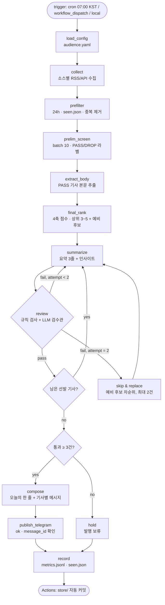

# Deep Interview Spec: 헬스케어 AI 데일리 뉴스레터 에이전트 (LangGraph)

## Metadata
- Interview ID: di-newsletter-20261029
- Rounds: 10 (+ Round 0 범위 확정, 운영 수정 1회)
- Final Ambiguity Score: 13%
- Type: greenfield
- Generated: 2026-10-29
- Threshold: 0.2
- Threshold Source: default
- Initial Context Summarized: yes (과제문 → 5단계 요건·제외 목록·제출 구조로 요약)
- Status: PASSED — **pending approval** (사용자 지시에 따라 구현 단계로 넘어가지 않음)

## Clarity Breakdown
| Dimension | Score | Weight | Weighted |
|-----------|-------|--------|----------|
| Goal Clarity | 0.90 | 0.40 | 0.360 |
| Constraint Clarity | 0.85 | 0.30 | 0.255 |
| Success Criteria | 0.85 | 0.30 | 0.255 |
| **Total Clarity** | | | **0.870** |
| **Ambiguity** | | | **0.130** |

## Topology
| Component | Status | Description | Coverage |
|-----------|--------|-------------|----------|
| 정의 | active | 분야 + 타깃 독자 페르소나 (audience.yaml 근거) | §1 |
| 수집 | active | 후보 8개 실측, 지표 3개로 채택 ≥3 | §2 |
| 선별 | active | 판단 문장, 예선(batch 10)/본선(4축), 3~5건 + 라벨 로그 | §3 |
| 요약·인사이트 | active | 본문 추출 후 한국어 요약 3줄 + 개발자/시장 인사이트 | §4 |
| 검수·예외처리 | active | 규칙 검사 + LLM 검수관, 재생성 2회 → 스킵·대체 → 발행 보류 | §5 |
| 발행·운영 | active | 텔레그램, GitHub Actions 매일 07:00 KST + 수동, metrics.jsonl | §6, §7 |

---

# REPORT.md 매핑용 명세

> 아래 §1~§7은 REPORT.md 6개 항목으로 바로 옮길 수 있도록 구성했다.
> REPORT.md 항목 ↔ 명세: ① 분야·독자 정의 = §1 / ② 소스 채택표 = §2 / ③ 선별 로직 = §3 / ④ 파이프라인 구조도 = §8 / ⑤ 실행 기록 = §6·§7 (+ 캡처) / ⑥ 회고 = §10 (템플릿)

## §1. 분야 및 독자 정의

**분야:** AI × 헬스케어·바이오

**선택 배경**
- 관심사가 'AI × 특정 산업'이었고, 후보 3개(헬스케어·바이오 / 금융·핀테크 / 교육) 중에서 골랐다.
- 제외 목록 6개를 빼고도 공개 소스가 풍부하다. 산업 매체, 규제기관 보도자료, 프리프린트, 오픈액세스 저널을 모두 쓸 수 있다.
- 인사이트 축(규제 승인, 임상 단계, 공개 데이터셋)이 분명해서 '단순 요약 이상'을 만들기 좋다.
- 의학 용어가 많아 요약 오류 위험이 크다. 이 위험은 오히려 검수 단계를 공들여 설계할 동기가 된다(§5).

**타깃 독자 페르소나**
| 항목 | 내용 |
|---|---|
| 누구 | 헬스케어 AI 개발자·취준생 (아이펠 수강생, 주니어 ML 엔지니어). 기술 이해도는 중~상, 의료 도메인 지식은 하~중 |
| 언제 | 평일·주말 오전 8시쯤 출근·등교길, 텔레그램으로 5분 안쪽 |
| 왜 | 헬스케어 AI 흐름을 매일 따라가고 싶지만 영어 논문·산업 기사를 직접 걸러 읽을 시간이 없다 |
| 얻어갈 것 | **기술과 시장의 혼합.** ① 이번 주에 직접 써볼 수 있는 모델·데이터·코드 1가지, ② 커리어·프로젝트 판단에 쓸 시장·규제 맥락 1줄 |

**audience.yaml 초안**
```yaml
domain: "AI x Healthcare/Bio"
language: ko
persona:
  who: "헬스케어 AI 개발자·취준생 (아이펠 수강생, 주니어 ML 엔지니어)"
  when: "매일 오전 8시경, 모바일 텔레그램, 5분 이내"
  needs:
    - "이번 주에 직접 써볼 수 있는 모델·데이터셋·코드·벤치마크"
    - "커리어·프로젝트 방향 판단에 영향을 주는 승인·투자·규제·채용 소식"
importance_question: >
  헬스케어 AI 개발자·취준생이 ① 이번 주 안에 직접 써볼 수 있거나(모델·데이터·코드 공개)
  ② 커리어·프로젝트 방향 판단을 바꾸는(승인·투자·규제·채용) 새로운 사실을 담고 있는가?
exclude:
  sources:  # 과제 제외 목록
    - https://openai.com/blog/rss.xml
    - https://deepmind.google/blog/rss.xml
    - https://techcrunch.com/category/artificial-intelligence/feed/
    - https://www.theverge.com/rss/ai-artificial-intelligence/index.xml
    - https://www.technologyreview.com/feed/
    - https://www.aitimes.com/rss/allArticle.xml
  conditions:
    - "AI와 무관한 일반 의료·제약 뉴스 (예선 DROP)"
    - "보도 원문 없이 홍보성 문구만 있는 기사"
    - "이미 발행한 URL (store/seen.json)"
    - "수집 시점 기준 24시간 이전 기사"
selection:
  prelim_batch_size: 10
  final_axes: [practicality, novelty, impact, credibility]   # 각 1~5
  final_count: {min: 3, max: 5}
  max_per_source: 2
review:
  max_regenerations: 2
  max_replacements: 2
  min_publish: 3
```

## §2. 소스 채택표 (측정 설계)

**측정 지표와 채택 기준** (실측 기간은 최근 7일. 지표 3개를 **모두** 통과해야 채택)
| 지표 | 측정 방법 | 채택 기준 |
|---|---|---|
| 업데이트 빈도 | 최근 7일 항목 수 (RSS/API 날짜 필드) | 주 7건 이상 |
| 본문 접근성 | 표본 기사의 본문 추출 성공률 (추출 텍스트 500자 이상이면 성공. 유료 장벽·차단·JS 전용은 실패) | 80% 이상 |
| 주제 적합도 | 표본 20건 중 '헬스케어×AI' 해당 비율 (LLM 라벨 + 수기 확인 5건) | 30% 이상 |
| 중복도 (참고용) | 다른 후보와 같은 사건을 다룬 비율 | 탈락 기준은 아님. 동점일 때 판단에 사용 |

**후보 목록** (실측값은 구현 단계에서 채운다. 채택은 최소 3개)
| # | 소스 | 언어 | 성격 | 수집 방식 | 빈도 | 접근성 | 적합도 | 채택 | 근거 |
|---|---|---|---|---|---|---|---|---|---|
| 1 | STAT News | EN | 시장·규제 | RSS | | | | | STAT+ 유료 비중이 접근성 위험 |
| 2 | Fierce Biotech | EN | 산업·투자 | RSS | | | | | |
| 3 | MobiHealthNews | EN | 디지털헬스 | RSS | | | | | |
| 4 | arXiv API (cs.LG/cs.CV/eess.IV + 의료 키워드) | EN | 기술 | API | | | | | 양은 많지만 적합도 필터 필요 |
| 5 | npj Digital Medicine | EN | 오픈액세스 논문 | RSS | | | | | 빈도가 기준 미달일 위험 |
| 6 | 식약처 보도자료 | KO | 규제 | RSS/게시판 | | | | | AI 비중(적합도)이 위험 |
| 7 | 메디게이트뉴스 | KO | 의료 산업 | RSS | | | | | |
| 8 | 히트뉴스 | KO | 제약·바이오 산업 | RSS | | | | | |
| (예비) | Hugging Face Blog | EN | 기술 | RSS | | | | | 헬스 비중이 낮을 것으로 예상 |

- 한국어 소스 비중을 늘린다(사용자 결정). 채택 결과에 한국어 소스가 1개 이상 들어가는 것을 목표로 한다.
- 측정은 별도 스크립트로 한 번 수행한다. 원자료는 `store/source_eval.json`에 저장하고, 표의 수치적 근거로 쓴다.

## §3. 선별 로직 설계

**중요도 판단 문장**
> "헬스케어 AI 개발자·취준생이 ① 이번 주 안에 직접 써볼 수 있거나(모델·데이터·코드 공개) ② 커리어·프로젝트 방향 판단을 바꾸는(승인·투자·규제·채용) 새로운 사실을 담고 있는가?"

**2단계 구조**
| 단계 | 입력 | 방법 | 출력 (모두 metrics.jsonl에 기록) |
|---|---|---|---|
| 사전 필터 (코드) | 수집 전체 | 24시간 이내, seen.json 중복 제거, URL·제목 정규화로 중복 제거 | 남은 건수 |
| 예선 | 제목 + RSS 요약 | LLM, **batch 10건**씩 판단 문장을 적용 | 기사별 `PASS/DROP`, 근거 유형 `①/②/none`, 한 줄 이유, batch 번호 |
| 본문 추출 | 예선 PASS 기사 | trafilatura 등으로 본문 추출. 실패하면 DROP(사유: extract_fail) | 추출 성공 여부·길이 |
| 본선 | PASS 기사 본문 전체 (약 10~15건) | 한 번의 LLM 호출로 상대 비교. 4축(실용성·새로움·영향력·신뢰도) 각 1~5점 | 축별 점수·총점·순위·선발 여부. 상위 3~5건 선발 (소스당 최대 2건). 차순위는 '예비 후보'로 보관 |

**batch 크기 설정 이유**
- **예선 10건:** 하루 수집량 50~100건 기준으로 호출 5~10회면 끝난다. 프롬프트가 짧아서 중간 기사 누락(lost-in-the-middle)과 순서에 따른 판정 흔들림이 줄어든다. 한 batch가 실패해도 10건만 다시 돌리면 된다. 비용과 정확도의 절충점이다.
- **본선은 나누지 않는다:** 본선은 절대평가가 아니라 '오늘 무엇이 더 중요한가'를 가리는 상대 비교다. 후보를 한 프롬프트에 모두 넣어야 순위가 일관된다.

**의도대로 동작했다는 근거**
- 예선 라벨과 본선 점수를 `metrics.jsonl`에 기사 단위로 남긴다.
- REPORT에는 하루치 라벨 표 발췌(PASS/DROP 예시와 이유)를 싣는다.
- 단계별 건수 퍼널(수집 → 예선 → 본선 → 발행)도 함께 제시한다.

## §4. 요약·인사이트 형식

- 요약과 인사이트는 **본문을 추출한 뒤에만** 생성한다. RSS 요약만으로 생성하는 것은 금지다.
- 출력은 한국어다. 영문 기사는 번역해서 요약하고, 수치·고유명사는 원문 표기를 그대로 둔다.

```
📰 [날짜] 헬스케어 AI 데일리
💡 오늘의 한 줄: (오늘 선발 기사 전체를 관통하는 흐름 1문장)

■ [제목] — 출처 · 날짜 · 원문 링크 · [근거 수준: 동료심사 논문 | 프리프린트 | 보도자료 | 기사]
• 핵심 요약 3줄 (본문에 있는 사실만)
• 👩‍💻 개발자 관점: 지금 해볼 수 있는 것 1개
• 📈 시장·규제 맥락: 왜 중요한지 1줄
• ⚠️ 한계: 표본 수, 미검증 여부 등 (있을 때만)
```

## §5. 자동 검수 및 예외 처리

**검사 방법 (2겹)**
1. **규칙 검사 (코드, LLM 비용 0)**
   - 요약 속 숫자·날짜가 모두 본문에 있는가
   - 고유명사(기관·제품·모델명)가 원문 표기로 본문에 있는가
   - 원문 링크가 HTTP 200으로 열리는가
   - 형식 필드(요약 3줄, 개발자 관점, 시장 맥락, 근거 태그)가 빠짐없는가
2. **LLM 검수관 (생성과 분리된 프롬프트)**
   - 요약 문장마다 본문의 근거 문장을 인용하게 하고 `SUPPORTED / UNSUPPORTED / CONTRADICTED`로 판정한다.
   - 인사이트는 본문과 모순되거나 과장하는지만 검사한다. 예: 승인되지 않았는데 '승인'이라고 쓴 경우, 프리프린트를 '입증'이라고 쓴 경우.

**통과 조건:** 규칙 검사 전부 통과 + 요약 문장 100% SUPPORTED + 인사이트 모순·과장 0건

**실패 시 대안**
```
검수 실패 → 실패 사유를 피드백으로 넣어 재생성 (최대 2회)
          → 그래도 실패하면 해당 기사 SKIP → 본선 예비 후보 중 차순위로 대체 (대체 최대 2건, 대체 기사도 같은 검수 적용)
          → 최종 통과가 3건 미만이면 발행하지 않고 status=held로 기록
```

## §6. 발행 채널

- **채널:** 텔레그램 봇 (Bot API `sendMessage`, `parse_mode=HTML`)
- **분할:** 메시지 하나의 한도가 4096자라서, 헤더('오늘의 한 줄') 1개와 기사 1건당 메시지 1개로 나눠 보낸다.
- **발행 성공 판정:** 모든 메시지 응답이 `ok: true`이고 `message_id`를 받았을 때만 성공이다. 일부만 실패하면 해당 메시지를 1회 재시도하고, 그래도 실패하면 `publish.status=partial`로 기록한다.
- **seen.json 갱신 조건:** 발행에 성공한 기사의 URL만 넣는다. 보류·실패한 기사는 다음 실행에서 다시 후보가 될 수 있다.
- **Secrets:** `TELEGRAM_BOT_TOKEN`, `TELEGRAM_CHAT_ID`, LLM API 키
- **실행 기록 (REPORT ⑤):** 텔레그램 발행 화면 캡처와 해당 run의 metrics 발췌, Actions 실행 로그 캡처를 넣는다.

## §7. 실행 주기와 기록

**GitHub Actions (과제 제출 기간에만 사용하고, 이후에는 끈다)**
- **트리거:**
  - `schedule: cron "0 22 * * *"`: UTC 22:00 = **매일 07:00 KST**
  - `workflow_dispatch`: Actions 탭의 **Run workflow** 수동 실행 버튼
- **실행 범위:** `python run.py`. 수집 범위는 지난 24시간이다. 로컬 수동 실행도 같은 명령으로 한다.
- **자동 커밋:** 실행이 끝나면 `store/seen.json`과 `store/metrics.jsonl`을 저장소에 자동 커밋한다.
  - workflow에 `permissions: contents: write`를 둔다.
  - 커밋 작성자는 `github-actions[bot]`이다.
  - 커밋 메시지 예: `chore(store): run <run_id> [skip ci]`
  - 변경이 없으면 커밋을 건너뛴다(`git diff --quiet`).
  - 발행 보류(held)나 실패한 run도 metrics는 커밋한다.
- **알아둘 점:** GitHub의 schedule 실행은 부하 시간대에 수 분~수십 분 지연될 수 있다. 정각 실행이 꼭 필요하면 cron 분을 조정하는 것을 검토한다.

**워크플로 끄는 방법 (README와 REPORT에 기재)**
- 웹: 저장소 → **Actions** 탭 → 왼쪽에서 해당 워크플로 선택 → 오른쪽 위 **`···`** → **Disable workflow**. 다시 켤 때는 같은 위치의 **Enable workflow**.
- CLI: `gh workflow disable "<workflow 이름 또는 파일명>"` / `gh workflow enable ...`
- 영구 제거: `.github/workflows/<파일>.yml`을 삭제하고 커밋한다.

**store/metrics.jsonl 스키마** (한 줄 = 이벤트 1개, 공통 필드 `run_id`, `ts`, `event`)
| event | 필드 |
|---|---|
| `collect` | source, fetched, in_window, extract_ok, extract_fail, duration_ms |
| `prelim` | item_id, url, source, batch_no, label(PASS/DROP), reason_type(①/②/none), reason |
| `final` | item_id, scores{practicality,novelty,impact,credibility}, total, rank, selected(bool), reserve(bool) |
| `review` | item_id, attempt, rule_fail[], supported, unsupported, contradicted, insight_issues[], outcome(pass/regenerated/skipped/replaced) |
| `publish` | status(published/partial/held), message_ids[], char_counts[], item_ids[] |
| `run_summary` | started_at, ended_at, duration_s, trigger(schedule/workflow_dispatch/local), model, llm_calls, tokens_in, tokens_out, est_cost_usd, funnel{collected,prefiltered,prelim_pass,final_selected,published}, errors[] |

## §8. 파이프라인 구조도 (REPORT ④ 초안)



**State (TypedDict 초안)**
| 필드 | 설명 |
|---|---|
| run_id, trigger, started_at | 실행 메타데이터 |
| config | audience.yaml 내용 |
| raw_items[] | 수집 원본 (id, source, url, title, summary, published_at) |
| candidates[] | 사전 필터 이후 |
| prelim_labels[] | 예선 라벨 |
| bodies{item_id: text} | 추출 본문 |
| ranked[], selected[], reserves[] | 본선 결과 |
| drafts{item_id: draft} | 요약·인사이트 |
| review_results{item_id: [...]} | 시도별 검수 결과 |
| attempts{item_id: n}, replacements_used | 예외 처리 카운터 |
| approved[] | 검수 통과 기사 |
| newsletter{header, messages[]} | 발행본 |
| publish_result | status, message_ids |
| metrics_events[] | 기록 버퍼 |

## §9. 제출 디렉토리 (예정)
```
my-newsletter/
├── .github/workflows/newsletter.yml   # cron 07:00 KST + workflow_dispatch + store 자동 커밋
├── graph.py                           # LangGraph 노드·엣지·State
├── run.py                             # 진입점 (로컬/Actions 공용)
├── audience.yaml                      # §1 초안
├── requirements.txt
├── store/metrics.jsonl  store/seen.json  store/source_eval.json
├── README.md                          # 실행법 + Disable workflow 방법
└── REPORT.md                          # 6개 항목
```

## §10. 회고 템플릿 (REPORT ⑥, 구현 후 작성)
- 가장 공들인 부분 후보: 검수 2겹 설계(규칙 + 근거 인용형 LLM 검수관)와 예외 처리 흐름, 소스 채택의 수치 근거
- 개선점 기록 항목: 소스 실측과 실제 운영의 차이, 예선 DROP 오판 사례, 재생성·스킵 발생률, 비용

---

## Goal
매일 07:00 KST에 헬스케어 AI 개발자·취준생을 위해 3개 이상 소스(제외 목록 미사용)에서 지난 24시간 기사를 수집한다. 예선(batch 10)과 본선(4축)으로 3~5건을 선별하고, 본문 기반 한국어 요약과 개발자·시장 인사이트를 만든다. 2겹 자동 검수를 통과한 내용만 텔레그램으로 발행하고, 전 과정을 metrics.jsonl에 기록하는 LangGraph 파이프라인이다.

## Constraints
- 과제 제외 목록 6개 소스는 사용하지 않는다.
- 채택 소스는 3개 이상이며, 지표 3개(빈도 ≥ 7건/주, 접근성 ≥ 80%, 적합도 ≥ 30%)를 모두 통과해야 한다.
- 최종 발행은 3~5건이다. 3건 미만이면 발행하지 않는다(held). 한 소스에서는 최대 2건이다.
- 재생성은 기사당 최대 2회, 대체는 run당 최대 2건이다.
- GitHub Actions는 과제 제출 기간에만 사용하고 이후 Disable한다.
- 비밀값은 GitHub Secrets에만 둔다.

## Non-Goals
- 구독자 관리, 웹 아카이브, 다채널 발행
- 의학적 조언이나 투자 조언 제공
- 실시간·하루 여러 번 발행
- 이번 단계에서의 구현 (명세 저장까지만 한다)

## Acceptance Criteria
- [ ] `store/source_eval.json`에 후보 8개 이상의 지표 3개 실측값이 있고, 채택 소스가 3개 이상이며 제외 목록 URL이 0개다.
- [ ] 1회 실행의 metrics.jsonl에 `collect` / `prelim` / `final` / `review` / `publish` / `run_summary` 이벤트가 모두 존재한다.
- [ ] 모든 예선 대상 기사에 `prelim` 라벨(PASS/DROP + 이유)이 있고, batch 크기가 10 이하다.
- [ ] 발행 기사 수가 3~5이고, 소스당 2건 이하다.
- [ ] 발행된 모든 기사가 `review.outcome ∈ {pass, regenerated, replaced}`이고, 해당 시도의 unsupported = 0, contradicted = 0이다.
- [ ] 의도적으로 오류를 주입한 요약(숫자 변조)이 검수에서 실패하고, 재생성이나 스킵으로 처리된다(테스트 1건).
- [ ] 텔레그램 응답이 전부 `ok:true`이고 `message_id`가 기록된다. 발행 화면 캡처를 확보한다.
- [ ] workflow에 `schedule(0 22 * * *)`와 `workflow_dispatch`가 있고, 실행 후 store/ 변경이 bot 커밋으로 반영된다.
- [ ] README 또는 REPORT에 Disable workflow 방법(웹·CLI)이 적혀 있다.
- [ ] REPORT.md의 6개 항목이 모두 채워진다(Mermaid 구조도 포함).

## Assumptions Exposed & Resolved
| Assumption | Challenge | Resolution |
|---|---|---|
| 개발자 독자에게는 기술 소식만 중요하다 | (반대로 생각하기) 규제·시장이 더 쓸모 있을 수 있다 | 기술 위주 + 기사마다 시장·규제 맥락 1줄 |
| 영문 소스 위주로 충분하다 | 독자가 한국 취준생이다 | 한국어 후보 3개로 확대 |
| 예선도 정교해야 한다 | (최소한으로 줄이기) 제목+요약만으로 충분한가 | 예선은 제목+요약 batch 10, 본문은 PASS 기사만 추출 |
| 매일 반드시 발행해야 한다 | 품질 미달일 때도 발행하는가 | 3건 미만이면 held (과제 요건 3~5건 우선) |
| Actions를 계속 돌린다 | 과제 이후 비용·소음 | 제출 기간 이후 Disable, 끄는 방법 문서화 |

## Technical Context
- Python, LangGraph (StateGraph + 조건부 엣지로 검수 루프), feedparser, arXiv API, trafilatura(본문 추출), Telegram Bot API, GitHub Actions
- **미결정 (구현 단계에서 결정):** LLM 공급자·모델, 한국어 소스의 RSS 제공 여부(없으면 게시판 스크래핑 또는 교체)

## Ontology (Key Entities)
| Entity | Type | Fields | Relationships |
|---|---|---|---|
| Newsletter | core | date, header_line, messages | Newsletter has 3~5 NewsletterItems |
| Persona | core | who, when, needs | Persona defines ImportanceQuestion |
| Source | core | name, url, lang, method, metrics | Source yields Articles; evaluated by SourceMetric |
| SourceMetric | supporting | frequency, accessibility, topic_fit, overlap | SourceMetric decides Source adoption |
| Article | core | id, url, title, summary, body, published_at | Article gets PrelimLabel, FinalScore |
| PrelimLabel | supporting | label, reason_type, reason, batch_no | — |
| FinalScore | supporting | 4 axes, total, rank, selected, reserve | — |
| NewsletterItem | core | summary3, dev_action, market_context, limits, evidence_tag | NewsletterItem checked by ReviewResult |
| ReviewResult | supporting | attempt, rule_fail, verdict counts, outcome | — |
| RunMetrics | supporting | event types ×6 | RunMetrics records Run |

## Ontology Convergence
| Round | Entity Count | New | Stable | Stability |
|---|---|---|---|---|
| 1 | 4 | 4 | - | - |
| 2 | 4 | 0 | 4 | 100% |
| 3 | 5 | 1 | 4 | 80% |
| 4 | 5 | 0 | 5 | 100% |
| 5 | 6 | 1 | 5 | 83% |
| 6 | 8 | 2 | 6 | 75% |
| 7 | 9 | 1 | 8 | 89% |
| 8 | 10 | 1 | 9 | 90% |
| 9~10 | 10 | 0 | 10 | 100% |

## Interview Transcript
<details>
<summary>Q&A 요약 (10 rounds)</summary>

- **R0** 범위 확정: 6개 구성요소 그대로
- **R1** 관심사: AI × 특정 산업 (모호도 74%)
- **R2** 분야: AI × 헬스케어·바이오 (66%)
- **R3** 독자: 헬스케어 AI 개발자/취준생 (61%)
- **R4** 얻어갈 것: 기술 + 시장의 혼합 (52%)
- **R5** 소스: 지표 3개와 기준 수용, 한국어 소스 비중 확대 (44%)
- **R6** 선별: 판단 문장, 예선 batch 10, 본선 4축, 소스당 최대 2건 (34%)
- **R7** 형식: 요약 3줄 + 개발자 관점 + 시장 맥락 + 한계, '오늘의 한 줄' (30%)
- **R8** 검수: 규칙 + LLM 검수관, 재생성 2회 → 스킵·대체 2건 → 3건 미만 held (21%)
- **R9** 채널: 텔레그램 (18%)
- **R10** 운영: GitHub Actions(제출 기간 한정), 07:00 KST cron + workflow_dispatch, store/ 자동 커밋, Disable 방법 문서화 (13%)
</details>
