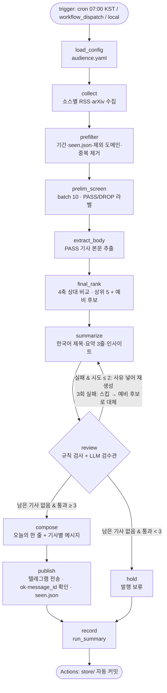

# REPORT — 헬스케어 AI 데일리

매일 07:00 KST에 헬스케어 AI 소식을 수집·선별·요약·검수해 텔레그램으로 발행하는 LangGraph 뉴스레터 에이전트.

- 저장소: https://github.com/borigunbbang/my-newsletter
- 실행 기록 원본: [`store/metrics.jsonl`](store/metrics.jsonl), 소스 실측 원본: [`store/source_eval.json`](store/source_eval.json)
- 설계 명세(요구사항 인터뷰 결과): [`.omc/specs/deep-interview-healthcare-ai-newsletter.md`](.omc/specs/deep-interview-healthcare-ai-newsletter.md)

---

## 1. 분야 및 독자 정의

### 분야: AI × 헬스케어·바이오

- 관심사가 'AI × 특정 산업'이었고, 후보 3개(헬스케어·바이오 / 금융·핀테크 / 교육) 중에서 골랐다.
- 제외 목록 6개를 빼고도 공개 소스가 많다. 산업 매체, 규제기관 보도자료, 프리프린트, 오픈액세스 저널을 모두 쓸 수 있다.
- 인사이트 축(규제 승인, 임상 단계, 공개 데이터셋·코드)이 분명해서 '단순 요약 이상'을 만들기 좋다.
- 의학 용어와 수치가 많아 요약 오류 위험이 크다. 이 위험 때문에 검수 단계를 공들여 설계했다(§4).

### 타깃 독자 페르소나

| 항목 | 내용 |
|---|---|
| 누구 | 헬스케어 AI 개발자·취준생 (아이펠 수강생, 주니어 ML 엔지니어). 기술 이해도는 중~상, 의료 도메인 지식은 하~중 |
| 언제 | 매일 오전 8시쯤, 모바일 텔레그램, 5분 안쪽 |
| 왜 | 헬스케어 AI 흐름을 매일 따라가고 싶지만 영어 논문·산업 기사를 직접 걸러 읽을 시간이 없다 |
| 얻어갈 것 | ① 이번 주에 직접 써볼 수 있는 모델·데이터·코드 ② 커리어·프로젝트 판단에 쓸 승인·투자·규제·채용 맥락 |

설정은 [`audience.yaml`](audience.yaml)의 `persona`, `importance_question`, `exclude`에 있다.

---

## 2. 소스 채택표

### 측정 방법과 채택 기준

[`tools/eval_sources.py`](tools/eval_sources.py)로 후보를 실측했다. 지표 3개를 **모두** 통과해야 채택한다.

| 지표 | 측정 방법 | 기준 |
|---|---|---|
| 업데이트 빈도 | RSS 날짜 기준 최근 7일 항목 수 | 주 7건 이상 |
| 본문 접근성 | 최신 기사 10건을 trafilatura로 추출, 500자 이상이면 성공 | 80% 이상 |
| 주간 적합 기사 수 | 최신 20건의 제목·요약을 LLM이 '헬스케어×AI인가'로 판정한 비율(적합도) × 빈도 | 주 7건 이상 |

**기준 변경 기록.** 처음에는 세 번째 지표를 '적합도 비율 30% 이상'으로 잡았다. 그런데 1차 실측에서 arXiv·npj 2개만 통과해 최소 3개를 채우지 못했다. 일반 의료 매체는 AI 기사 비율이 낮지만(15~25%) 기사 수가 많아 AI 기사 절대량은 충분했다. 비율이 낮은 소스의 무관한 기사는 어차피 예선에서 걸러진다. 그래서 '비율'이 아니라 '일주일에 쓸 만한 기사가 몇 건 나오는가'로 기준을 바꿨다. 바꾸기 전에 기준은 그대로 두고 AI 섹션 피드(STAT AI 토픽, MedCity AI 태그, 더바이오 헬스케어·AI 섹션)를 먼저 시도했다. 하지만 섹션 피드는 적합도는 높아도(65~90%) 빈도가 주 0~5건이라 탈락했다.

### 전체 후보 (24개)

**실측 대상 (12개)**

| 소스 | 언어 | 빈도(주) | 접근성 | 적합도 | 주간 적합 | 결과 | 근거 |
|---|---|---|---|---|---|---|---|
| **arXiv (cs.LG·cs.CV·eess.IV + medical/clinical)** | EN | 83 | 100% | 85% | **70.5** | ✅ 채택 | 세 지표 모두 통과 |
| **더바이오** | KO | 50+ | 100% | 25% | **12.5** | ✅ 채택 | 세 지표 모두 통과 |
| **청년의사** | KO | 50+ | 100% | 15% | **7.5** | ✅ 채택 | 세 지표 모두 통과 |
| npj Digital Medicine | EN | 8 | 100% | 75% | 6.0 | ❌ | 주간 적합 < 7 (1차 실측은 88% → 7.0으로 경계선) |
| MedCity News | EN | 26 | 100% | 20% | 5.2 | ❌ | 주간 적합 < 7 |
| 히트뉴스 | KO | 50+ | 100% | 5% | 2.5 | ❌ | 주간 적합 < 7 (제약 산업 위주) |
| STAT News | EN | 20+ | 100% | 10% | 2.0 | ❌ | 주간 적합 < 7 (정책·약가 위주) |
| 식약처 보도자료 | KO | 21 | 100% | 5% | 1.1 | ❌ | 주간 적합 < 7 |
| STAT News · AI 토픽 | EN | 5 | 100% | 65% | 3.2 | ❌ | 빈도 < 7 |
| MedCity News · AI 태그 | EN | 0 | 100% | 90% | 0.0 | ❌ | 빈도 < 7 (최근 글이 2주 전) |
| 더바이오 · 헬스케어·AI 섹션 | KO | – | – | – | – | 측정 불가 | HTTP 403 (아래 참고) |
| 히트뉴스 · 의료기기 섹션 | KO | – | – | – | – | 측정 불가 | HTTP 403 (아래 참고) |

**RSS 단계에서 탈락 (8개)**

| 소스 | 결과 | 근거 |
|---|---|---|
| Fierce Biotech | ❌ | HTTP 403 — RSS 자동 접근 차단 |
| MobiHealthNews | ❌ | HTTP 403 — RSS 자동 접근 차단 |
| Healthcare IT News | ❌ | HTTP 403 — RSS 자동 접근 차단 |
| 메디게이트뉴스 | ❌ | RSS 주소가 로그인 페이지로 연결 (항목 0건) |
| 메디포뉴스 | ❌ | HTTP 404 — RSS 없음 |
| 메디컬타임즈 | ❌ | HTTP 404 — RSS 없음 |
| Lancet Digital Health | ❌ | 월간 발행, 최근 7일 0건 |
| Hugging Face Blog | ❌ | 최근 7일 6건 — 빈도 < 7 |

**예비 후보 (RSS만 확인, 실측 안 함):** 의학신문, 의협신문, Healthcare Dive, Endpoints News

### 측정상 주의점

- **빈도는 하한값이다.** 더바이오·청년의사·히트뉴스(최신 50건), STAT(20건), npj(8건)는 피드에 보이는 항목이 전부 최근 7일 안이었다. 실제 주간 발행량은 표보다 많을 수 있다.
- **한국 매체 3곳(더바이오·청년의사·히트뉴스)의 수치는 1차 실측 값이다.** AI 섹션 RSS를 찾느라 섹션 번호를 짧은 시간에 연속 조회했더니, 같은 기사 시스템을 쓰는 매체들이 이 컴퓨터 IP를 403으로 막았다. 그래서 2차 실측 때 0건이 기록됐고, 1차 실측 출력값으로 복원했다(`source_eval.json`의 `note` 필드에 표시). GitHub Actions에서는 정상 수집된다.
- 403 차단은 우회(브라우저 위장 등)하지 않고 그대로 탈락 근거로 기록했다.
- STAT은 유료 기사(STAT+)가 많은데도 접근성이 100%로 나왔다. 무료 미리보기만으로 500자를 넘긴 것으로 보인다. 적합도에서 이미 탈락해서 판정에는 영향이 없다.

---

## 3. 선별 로직 설계

### 중요도 판단 문장

> 헬스케어 AI 개발자·취준생이 ① 이번 주 안에 직접 써볼 수 있거나(모델·데이터·코드 공개) ② 커리어·프로젝트 방향 판단을 바꾸는(승인·투자·규제·채용) 새로운 사실을 담고 있는가?

### 2단계 구조

| 단계 | 입력 | 방법 | 기록 (`metrics.jsonl`) |
|---|---|---|---|
| 사전 필터 (코드) | 수집 전체 | 수집 기간(48h, arXiv 72h), `seen.json` 재발행 방지, 제외 목록 도메인 차단, URL·제목 정규화 중복 제거 | `run_summary.funnel` |
| **예선** | 제목 + RSS 요약 | LLM, **10건씩 batch**로 판단 문장 적용 → `PASS/DROP` | `prelim`: 라벨, 근거 유형(①/②/none), 한 줄 이유, batch 번호 |
| 본문 추출 | 예선 PASS | trafilatura, 500자 미만이면 DROP(`extract_fail`) | `extract`: 성공 여부, 글자 수 |
| **본선** | PASS 기사 본문 전체 | **한 번의 LLM 호출**로 상대 비교. 4축(실용성·새로움·영향력·신뢰도) 각 1~5점 | `final`: 축별 점수, 총점, 순위, 선발·예비 여부 |
| 선발 | 본선 순위 | 상위 최대 5건, **소스당 최대 2건**. 나머지는 예비 후보(검수 실패 시 대체용) | 〃 |

예선 PASS/DROP 조건은 `audience.yaml`의 `prelim`에 있다.
- **PASS** ① 코드·데이터셋·모델·벤치마크 공개 또는 의료 AI 과제에 바로 쓸 수 있는 범용 도구·평가 방법, ② 실제 환자·병원 대상 검증·도입, 승인·규제·투자·채용 소식
- **DROP** 헬스케어 적용 없는 일반 ML, 독자가 쓰기 어려운 좁은 세부 연구, AI 무관, 홍보성

### batch 크기 설정 이유

- **예선 10건:** 하루 수집량 약 125건 기준으로 13회 호출이면 끝난다. 프롬프트가 짧아 중간 기사 누락(lost-in-the-middle)과 순서에 따른 판정 흔들림이 줄어든다. 한 batch가 실패해도 10건만 다시 돌리면 된다.
- **본선은 나누지 않는다:** 본선은 절대평가가 아니라 '오늘 무엇이 더 중요한가'를 가리는 상대 비교다. 후보(약 25건)를 한 프롬프트에 모두 넣어야 순위가 일관된다. 본문은 기사당 앞 2,000자만 넣어 길이를 제한했다.

### 기준이 의도대로 동작했다는 근거 (Actions 실행 `20261029-072223-f97af4`)

**퍼널:** 수집 125 → 사전 필터 125 → 예선 PASS 25 → 본문 추출 25/25 → 본선 선발 5 → 검수 통과 5 → **발행 5**

**소스별 예선 결과 (batch 13개)**

| 소스 | PASS | DROP |
|---|---|---|
| arXiv | 2 | 23 |
| 더바이오 | 10 | 40 |
| 청년의사 | 13 | 37 |

**예선 라벨 예시**

| 라벨 | 근거 | 소스 | 이유 (LLM 출력) |
|---|---|---|---|
| PASS | ② | arXiv | 오픈 소스 'MedJev' System One 모델을 로컬에서 실행 가능하다고 명시 — 의료 AI 개발자가 바로 내려받아 실험해볼 수 있음 |
| PASS | ② | arXiv | LumenMorph 기반의 합성 튜브 벤치마크(5,580개 이미지)와 툴킷 공개가 명시되어 데이터셋·도구를 즉시 사용 가능 |
| PASS | ② | 더바이오 | 초음파 기반 의료기기 스타트업 소노케어랩의 시드투자 유치 소식으로 투자·스타트업 생태계 신호 |
| DROP | none | arXiv | 의료 영상 분할의 불확실도 추정 방법 제안 논문이나, 초록에 코드·모델·데이터 공개 또는 임상 적용·검증 정보 없음 |
| DROP | none | 더바이오 | 인사(사내 인사 이동) 기사로 헬스케어 AI 개발자 관점에서 의미 있는 코드·임상·투자 소식이 아님 |
| DROP | none | 더바이오 | 바이오 M&A 전략 기사로 헬스케어 AI 개발자가 당장 활용할 수 있는 정보가 없음 |

**본선 상위 8건 점수**

| 순위 | 실용성 | 새로움 | 영향력 | 신뢰도 | 총점 | 결과 |
|---|---|---|---|---|---|---|
| 1 | 5 | 4 | 4 | 3 | 16 | 선발 |
| 2 | 1 | 4 | 4 | 4 | 13 | 선발 |
| 3 | 4 | 3 | 2 | 3 | 12 | 선발 |
| 4 | 2 | 3 | 4 | 3 | 12 | 선발 |
| 5 | 2 | 3 | 4 | 3 | 12 | 선발 |
| 6 | 1 | 3 | 3 | 4 | 11 | 예비 |
| 7 | 1 | 3 | 4 | 3 | 11 | 예비 |
| 8 | 1 | 3 | 4 | 3 | 11 | 예비 |

**예선 기준을 조정한 과정.** 같은 후보 26건(arXiv)으로 프롬프트를 3번 바꿔 가며 맞췄다.

| 버전 | 조건 | PASS | 문제 |
|---|---|---|---|
| v1 | ①·②에 해당하면 PASS | 2/26 | 너무 엄격. "초록에 코드 공개 명시 없음"으로 대부분 DROP |
| v2 | 가능성이 있으면 PASS, 명백히 무관할 때만 DROP | 26/26 | 너무 느슨. 의료와 무관한 언어모델 증류 논문까지 PASS |
| v3 (현재) | PASS·DROP 조건을 구체적인 항목으로 나열 | 12~16/26 | 의료 무관 논문은 DROP, 의료 영상·임상 NLP 도구는 PASS |

---

## 4. 파이프라인 구조도



### State ([`state.py`](state.py))

| 필드 | 쓰는 노드 | 설명 |
|---|---|---|
| `run_id`, `trigger`, `started_at` | run.py | 실행 메타데이터 |
| `config` | load_config | `audience.yaml` 내용 |
| `raw_items` | collect | 수집 원본 (id, source, url, title, summary, published_at) |
| `candidates` | prefilter | 사전 필터 이후 |
| `prelim_labels` | prelim_screen | 예선 PASS/DROP 라벨 |
| `bodies` | extract_body | item_id → 본문 |
| `ranked`, `selected`, `reserves`, `original_selected` | final_rank, review | 본선 순위, 선발(대체 포함), 예비 후보 |
| `drafts` | summarize | item_id → 제목·요약·인사이트 |
| `review_results`, `attempts`, `approved`, `skipped`, `replacements_used` | review | 시도별 검수 결과와 예외 처리 카운터 |
| `newsletter`, `publish_result` | compose, publish | 발행본, 발행 상태·message_id |
| `errors` | 전체 | 수집·발행 오류 |

### 자동 검수와 예외 처리 ([`nodes/review.py`](nodes/review.py))

1. **규칙 검사 (코드, LLM 비용 0)**
   - 요약·인사이트의 두 자리 이상 숫자와 소수가 본문에 그대로 있는가 (원문이 'ten'처럼 영어 단어로 쓴 수는 숫자로도 인정)
   - 영문 고유명사(대문자·숫자 포함 토큰)가 본문에 있는가
   - 요약이 정확히 3문장이고, 필수 항목이 비어 있지 않은가
   - 원문 링크가 열리는가 → 본문 추출에 성공한 기사만 여기까지 오므로 extract_body에서 확인된다
2. **LLM 검수관 (요약과 분리된 프롬프트)**
   - 요약 문장마다 근거가 되는 본문 문장을 인용하게 하고 `SUPPORTED / UNSUPPORTED / CONTRADICTED`로 판정한다.
   - 인사이트(개발자 관점·시장 맥락·한계)는 본문과 모순되거나 과장하는지만 본다 (예: 프리프린트를 '입증'이라고 씀).
3. **통과 조건:** 규칙 위반 0 + 요약 3문장 모두 SUPPORTED + 인사이트 문제 0
4. **실패 시 대안**
   - 실패 사유를 피드백으로 넣어 **재생성 (기사당 최대 2회)**
   - 그래도 실패하면 **스킵** → 본선 **예비 후보 차순위로 대체** (run당 최대 2건, 소스당 2건 제한 유지, 대체 기사도 같은 검수)
   - 최종 통과가 **3건 미만이면 발행하지 않고** `held`로 기록
   - 발행 단계: 메시지마다 1회 재시도, 일부만 실패하면 `partial`로 기록하고 성공한 기사만 `seen.json`에 추가

**오류 주입 테스트** ([`tests/test_review_injection.py`](tests/test_review_injection.py)): 요약 첫 문장에 본문에 없는 "정확도는 99.73%로 보고됐다"를 덧붙였다.

```
1차 검수: 실패 ✅
본문에 없는 숫자: 99.73
요약 [0] UNSUPPORTED
최종: 통과 (시도 2회)
```

숫자 규칙과 LLM 검수관이 둘 다 잡아냈고, 재생성된 요약에서는 가짜 수치가 사라졌다.

---

## 5. 실행 기록

**GitHub Actions 수동 실행** — [run 40834967634](https://github.com/borigunbbang/my-newsletter/actions/runs/40834967634), `workflow_dispatch`, 10분 27초, 성공

| 순위 | 소스 | 기사 | 예선 근거 |
|---|---|---|---|
| 1 | arXiv | MedJev — 로컬에서 실행 가능한 오픈 의사결정 모델 평가 | ② |
| 2 | 더바이오 | 엔허투 EU 조기 유방암 수술 후 보조요법 승인 | ② |
| 3 | arXiv | LumenMorph 합성 튜브 벤치마크(5,580개 이미지)·툴킷 공개 | ② |
| 4 | 청년의사 | 정부의 'K-제약바이오' 200개사 집중 육성 계획 | ② |
| 5 | 청년의사 | 원격중환자실 권역 확대·의료 AI 활용 | ② |

- 검수: 5건 모두 첫 시도에 통과 (SUPPORTED 3/3, 규칙 위반 0)
- 발행: 텔레그램 메시지 6개(헤더 1 + 기사 5) 모두 `ok:true`, message_id 13~18
- 기록: 실행 후 `github-actions[bot]`이 `store/metrics.jsonl`·`store/seen.json`을 커밋 (`chore(store): run 40834967634 [skip ci]`)

`metrics.jsonl` 발췌:

```json
{"event": "publish", "status": "published", "message_ids": [13, 14, 15, 16, 17, 18], "char_counts": [71, 999, 815, 1214, 820, 993]}
{"event": "run_summary", "duration_s": 607.0, "trigger": "workflow_dispatch", "funnel": {"collected": 125, "prefiltered": 125, "prelim_pass": 25, "final_selected": 5, "published": 5}, "publish_status": "published", "errors": []}
```

### 결과 화면

<!-- 캡처를 docs/ 폴더에 넣고 아래 경로를 맞추면 된다 -->

**텔레그램 발행 화면**


**GitHub Actions 실행 화면**


---

## 6. 프로젝트 회고

### 가장 공들인 부분

**1. 검수를 2겹으로 나누고, 실패했을 때의 경로까지 끝까지 연결했다.**
숫자·고유명사 같은 기계적인 오류는 코드로 비용 없이 잡고, 문장 단위 근거 확인은 요약과 분리된 LLM 검수관에게 본문 인용을 강제했다. 실패하면 재생성 → 스킵 → 예비 후보 대체 → 발행 보류로 이어지도록 LangGraph 조건부 엣지로 루프를 만들었다. 오류 주입 테스트로 이 경로가 실제로 동작하는 것을 확인했다.

**2. 소스 채택을 감이 아니라 실측 숫자로 정했다.**
후보 24개를 빈도·접근성·적합도로 측정했고, 차단·RSS 없음 같은 탈락 사유도 그대로 기록했다. 기준이 현실과 맞지 않을 때도 먼저 원래 기준으로 해결(AI 섹션 피드)을 시도한 뒤, 근거를 남기고 기준을 바꿨다.

### 개발하면서 부딪힌 문제와 해결

| 문제 | 원인 | 해결 |
|---|---|---|
| 예선이 2/26 → 26/26으로 극단적 | 판단 기준이 추상적 | PASS·DROP 조건을 구체 항목으로 나열 (§3) |
| 예선 라벨이 다른 기사에 밀려 붙고, 본선에서 같은 기사가 3번 채점됨 | LLM이 번호·긴 해시 ID를 옮겨 적다 틀림 | `A1`, `A2` 짧은 키로 묻고 되돌림. 중복은 무시, 누락은 한 번 더 질문 |
| 24시간 수집 기간으로 0건 | RSS 날짜가 날짜 단위이고, arXiv는 제출 1~2일 뒤 공개 | 기본 48h, arXiv 72h. 재발행은 `seen.json`이 막음 |
| 원문 "ten benchmarks"를 "10개"로 쓰면 검수 실패 | 숫자 규칙이 영어 숫자 단어를 모름 | zero~twenty를 숫자로도 인정 |
| 재생성 요약에 영어 일반 용어가 섞임 | "고유명사는 원문 표기" 규칙을 LLM이 넓게 적용 | "이름만 원문 표기, 일반 용어는 한국어로"로 프롬프트 수정 |
| 한국 매체 403 차단 | 섹션 RSS 번호를 짧은 시간에 연속 조회 | 실측값 복원·명시. 운영은 하루 1회 요청이라 영향 없음. 이후 탐색은 사이트당 1회만 요청 |

### 보완하고 싶은 점

1. **기술 소식과 산업 소식의 비율을 조절할 장치가 없다.** 판단 문장 ②는 헬스케어 AI 개발자의 커리어 판단에 쓰도록 승인·투자·규제 같은 바이오 산업 소식까지 일부러 넓게 잡았다. 그래서 이번 발행에는 '엔허투 EU 승인', 'K-제약바이오 육성 계획' 같은 산업 소식이 기술 소식(MedJev, LumenMorph)과 함께 들어갔다. 날에 따라 한쪽으로 쏠릴 수 있으니, "①·② 각각 최소 1건"처럼 선발 단계에 균형 조건을 두면 좋겠다.
2. **예선 판정이 실행마다 흔들린다.** 같은 npj 기사가 한 번은 PASS, 한 번은 DROP이었다. 경계선 기사는 두 번 판정해 다수결을 내거나, 판정 예시(few-shot)를 넣어 안정화할 수 있다.
3. **실행 시간이 10분이다.** 예선 batch와 기사별 요약·검수를 순서대로 처리하기 때문이다. 동시 처리로 바꾸면 2~3분으로 줄일 수 있다.
4. **소스 빈도 측정이 피드 길이에 묶인다.** 피드가 최신 20~50건만 보여주는 소스는 빈도가 과소 측정된다. 며칠에 걸쳐 수집해 실제 발행량을 재는 방식이 더 정확하다.
5. **소스 구성이 arXiv와 국내 산업 매체로 나뉜다.** 영어 산업 매체(STAT 등)는 적합도에서 모두 떨어졌다. 차단되지 않는 영어 디지털헬스 매체를 더 찾으면 균형이 좋아진다.

### 확장: 같은 플랫폼으로 다른 주제

주제에 관한 내용(독자, 판단 문장, 예선 조건, 본선 채점 축, 카드 항목, 발행 채널)을 모두 `audience.yaml`과 `source_candidates.yaml`로 옮겼다. 코드를 고치지 않고 설정만 바꿔, 강아지·고양이 힐링 뉴스레터 **멍냥 데일리**([pet-newsletter](https://github.com/borigunbbang/pet-newsletter))를 디스코드 발행으로 하나 더 만들었다.
